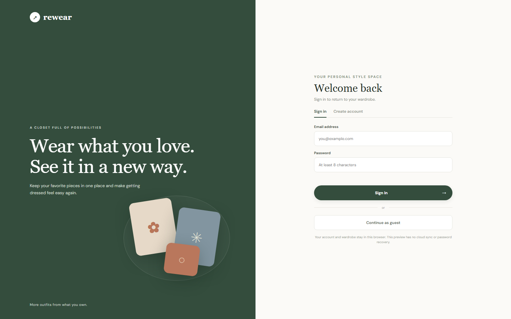

<div align="center">

# 👗 Rewear

### *Your wardrobe, reimagined.*

A mobile-friendly wardrobe stylist that helps you discover fresh outfits from the clothes and accessories you already own.

[](https://digvijay165.github.io/rewear-wardrobe-stylist/)


**[🌐 Live App](https://digvijay165.github.io/rewear-wardrobe-stylist/)** · **[🐛 Report Bug](https://github.com/digvijay165/rewear-wardrobe-stylist/issues)** · **[✨ Request Feature](https://github.com/digvijay165/rewear-wardrobe-stylist/issues)**

<br>

<a href="https://digvijay165.github.io/rewear-wardrobe-stylist/">
  
</a>

</div>

---

## 📖 About

**Rewear** helps you get more out of the closet you already have. Add photos of your pieces, choose where you're headed, and get outfit ideas built from your own wardrobe. Save the looks you love and come back to them anytime.

> 🌱 **Wear what you love. See it in a new way.** More outfits from what you own, with less buying.

> 🔗 **Try it live:** [digvijay165.github.io/rewear-wardrobe-stylist](https://digvijay165.github.io/rewear-wardrobe-stylist/)

---

## ✨ Features

| Feature | Description |
| --- | --- |
| 👤 **Local profiles** | Sign in, create an account, or **continue as a guest** |
| 📸 **Digital wardrobe** | Upload photos of your clothes and accessories |
| 🗂️ **Smart categories** | Tops, Bottoms, Dresses, Outerwear, Shoes, Bags, Jewellery & Accessories |
| 🎉 **Occasion styling** | Outfit ideas for Dinner, Date, Party, Friends, Picnic, Wedding, Baby shower & Brunch |
| ✨ **Style-based suggestions** | Pick a vibe and get a look built from your own pieces |
| 💾 **Saved looks** | Keep your favorite combinations in one place |
| 📱 **Mobile-first design** | Clean, responsive UI for phone, tablet, and desktop |
| ⚡ **Zero setup** | A single HTML file with no install and no build |

---

## 🧭 How It Works

1. **Sign in** with a local profile, or continue as a guest
2. **Add pieces** to your wardrobe by uploading photos
3. **Choose an occasion**: *"Where are you headed?"*
4. **Pick a style** and get your outfit idea
5. **Save the look** to revisit it later

---

## 🛠️ Tech Stack

- **HTML5**: app structure
- **CSS3**: custom responsive styling
- **Vanilla JavaScript**: wardrobe management, styling logic, and state
- **Web Storage API (`localStorage`)**: profiles, wardrobe items, and saved looks
- **Google Fonts**: *Manrope* & *DM Sans*
- **GitHub Pages**: static hosting

---

## 📁 Project Structure

```
rewear-wardrobe-stylist/
├── index.html            # The complete app (markup, styles, and scripts)
├── rewear-screenshot.png # README preview image
└── README.md
```

---

## 🚀 Getting Started

### Run locally

No installation needed: just clone and open.

```bash
git clone https://github.com/digvijay165/rewear-wardrobe-stylist.git
cd rewear-wardrobe-stylist
```

Then open `index.html` in any modern browser.

---

## 🌐 Deployment

Rewear is hosted on **GitHub Pages** from the `main` branch root.

| Setting | Value |
| --- | --- |
| Live URL | [digvijay165.github.io/rewear-wardrobe-stylist](https://digvijay165.github.io/rewear-wardrobe-stylist/) |
| Source | `main` branch, `/ (root)` |
| Entry file | `index.html` |
| Build command | *None* |

---

## 🔒 Privacy & Account Note

Rewear is a **static, browser-only app**:

- Profiles, wardrobe photos, and saved looks are stored **only in your browser** (`localStorage`)
- There is **no server, cloud sync, password recovery, or cross-device access**
- Clearing your browser data will remove your wardrobe

> ⚠️ **Do not reuse a sensitive password.** Accounts here are local to your browser and are not secured by a server.

---

## 🗺️ Roadmap

- [ ] Cloud sync and secure authentication
- [ ] AI-powered outfit recommendations
- [ ] Weather-aware styling
- [ ] Outfit calendar and wear tracking
- [ ] Share looks with friends

---

## 🤝 Contributing

Contributions, issues, and feature requests are welcome!

1. Fork the project
2. Create your branch (`git checkout -b feature/AmazingFeature`)
3. Commit your changes (`git commit -m "Add AmazingFeature"`)
4. Push to the branch (`git push origin feature/AmazingFeature`)
5. Open a Pull Request

---

## 👤 Author

**Digvijay**
- GitHub: [@digvijay165](https://github.com/digvijay165)

---

<div align="center">

⭐ **If you like this project, give it a star!** ⭐

Made with 💚 by [digvijay165](https://github.com/digvijay165)

</div>
